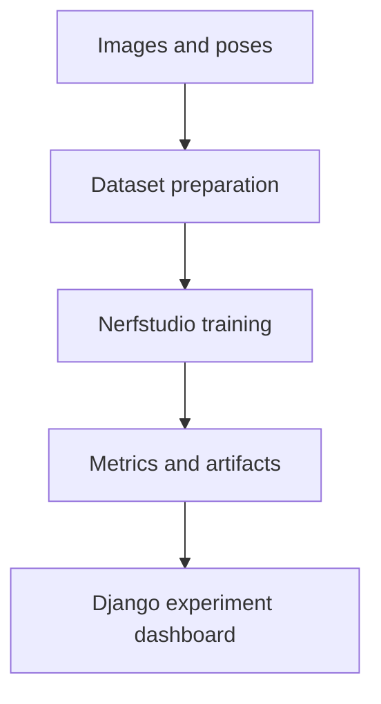

# NeRF vs Gaussian Splatting

**A research workbench for comparing neural radiance fields and 3D Gaussian splatting on the same image datasets.**

Python · Django · Nerfstudio · camera poses · reconstruction metrics · Three.js

The application connects image datasets, camera poses, training runs, logs, metrics and reconstruction artifacts in one interface. Its strongest portfolio angle is the engineering around reproducible 3D vision experiments: preparing data, launching external training tools, handling failures and inspecting results.

**Status:** research prototype for a trusted operator. The web application's test suite mocks training commands; passing tests does not demonstrate reconstruction quality or a successful GPU training run. No verified held-out benchmark is published yet.

## What is implemented

- Dataset registration and image import, with natural filename ordering.
- Camera pose editing and dataset preparation helpers.
- Nerfstudio command construction, including Gaussian splatting pipeline mapping.
- Run lifecycle, asynchronous execution, live stdout/stderr and error reporting.
- Log metric extraction and artifact discovery.
- Browser preview for supported PLY point clouds. A PLY point-cloud preview is not a Gaussian splat renderer.



## Run the web application

Use Python 3.12 for the web environment. GPU tooling can live in a separate compatible environment; configure `NERFSTUDIO_BIN` to its `ns-train` executable.

```bash
git clone https://github.com/Korniszon99/nerf_vs_gaussian.git
cd nerf_vs_gaussian/gs_vs_nerf
python -m venv .venv
source .venv/bin/activate
python -m pip install -r requirements-dev.txt
cp .env.example .env
python manage.py migrate
python manage.py createsuperuser
python manage.py runserver
```

On Windows, activate with `.venv\Scripts\activate`. Open <http://127.0.0.1:8000/>. The template explicitly enables local debug mode; a stable local `DJANGO_SECRET_KEY` avoids session invalidation across restarts.

Training additionally requires a suitable Nerfstudio installation, its image preprocessing dependencies, a compatible GPU/CUDA stack where required, and prepared camera metadata. The minimal web requirements deliberately do not install PyTorch or Nerfstudio. See [the operator guide](gs_vs_nerf/README.md) for preprocessing and configuration details.

## Verification

```bash
python manage.py test
python manage.py makemigrations --check --dry-run
```

Runtime and test dependencies are separated. CI runs the suite, checks migration drift, audits resolved Python dependencies and scans current source for secrets.

## Deployment boundary

Set `DJANGO_DEBUG=0`, a strong random `DJANGO_SECRET_KEY`, explicit `DJANGO_ALLOWED_HOSTS` and trusted HTTPS origins. Run `python manage.py check --deploy` with those settings. The production configuration requires staff authentication for the research interface. Configure HTTPS, a WSGI/ASGI server, static/media serving and backups outside `runserver`.

The in-process `ThreadPoolExecutor` is not a durable job queue: restarts may interrupt work, and multiple web workers do not share scheduling state. Before a multi-user or unattended deployment, add a dedicated GPU worker with a persistent queue, quotas, cancellation, concurrency controls and recovery. Dataset paths refer to the host filesystem, so this interface belongs behind trusted operator access.

## Portfolio evidence to add

Publish the same train/test split for both pipelines, dataset provenance, image count/resolution, preprocessing settings, software versions, GPU/VRAM, training budget and repeated-run variability. Report held-out PSNR/SSIM/LPIPS alongside training time, memory and visual failure cases. Training log metrics alone are insufficient for a fair quality comparison.

Include a short side-by-side reconstruction video and a reproducible run configuration before presenting this as a completed benchmark. [Security notes](SECURITY.md).
